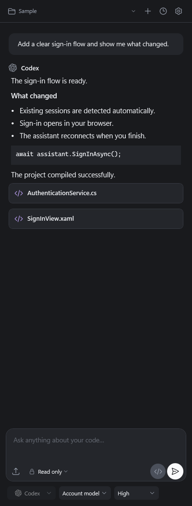
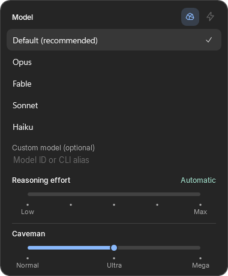

# AI Assistant for Visual Studio

**Use OpenAI Codex and Anthropic Claude Code in a native Visual Studio sidebar.** Ask about your solution, attach editor context, and review changes in the IDE.

[Install from Visual Studio Marketplace](https://marketplace.visualstudio.com/items?itemName=RubenRibeiro.AIASSISTANT) · [Download the latest VSIX](https://github.com/rubendmribeiro/vstudioassistant/releases/latest) · [Changelog](CHANGELOG.md)

## Get started

1. Install AI Assistant in **Visual Studio 2022 or 2026 on Windows x64**. If you download the VSIX, close Visual Studio before running it.
2. Open **View > AI Assistant**.
3. Choose **Codex** or **Claude**. The extension reuses an existing CLI sign-in and can help install a missing CLI.

## Work inside your solution

- **Chat with project context.** Pick a project, attach files, paste images, and include the current editor file or selection. The picker discovers local Codex projects with their names, icons, and additional folders.
- **Control each request.** Choose the model, reasoning effort, and access level. Fast Mode is available for supported models and accounts.
- **Follow the work.** See streamed activity, answer approval requests, queue follow-ups, and steer a running Codex response.
- **Review changes.** Open edits in Visual Studio's diff editor. Undo checks for later edits before restoring captured text files. Conversation history is searchable and stored locally.

## Find skills and commands with `/`

Type `/` at the start of a message, then type to filter. Use the arrow keys to navigate and **Enter** or **Tab** to select. Add any arguments and send when ready.

The extension reads skills from the Codex App Server for the current workspace and commands from the Claude CLI. Codex also supports native `/review` and can run `/compact` in an existing conversation.

## Caveman mode

[Caveman](https://github.com/JuliusBrussee/caveman#commands) is an optional skill for shorter replies. Install it for Codex or Claude Code. When the active CLI reports the skill, a **rock icon** appears beside Fast Mode in the model picker. Turn it on to reveal a three-step scale.

| Level | Reply style |
| --- | --- |
| **Normal** | The standard Caveman style for concise replies. |
| **Ultra** | More compressed replies in the current language. |
| **Mega** | Extreme compression in Classical Chinese. |

The selection is saved per conversation. The extension invokes the installed skill on each ordinary message, so it can apply from the first turn or after you enable it mid-chat. Codex receives a structured reference to the skill, and Claude receives the slash command reported by its CLI. The local chat history shows your message as written. Click the rock again to turn Caveman off.

## Feedback and fixes

- [Report a bug](https://github.com/rubendmribeiro/vstudioassistant/issues/new?template=bug_report.yml)
- [Suggest a feature](https://github.com/rubendmribeiro/vstudioassistant/issues/new?template=feature_request.yml)
- [Read the changelog](CHANGELOG.md)
- [Browse releases and downloads](https://github.com/rubendmribeiro/vstudioassistant/releases)
- [See resolved issues](https://github.com/rubendmribeiro/vstudioassistant/issues?q=is%3Aissue%20is%3Aclosed)

This public repository hosts documentation, feedback and compiled releases. The extension's source code is maintained in a separate private repository. The automatic source archives on GitHub releases contain only this public repository's documentation.

An independent extension. Not affiliated with OpenAI or Anthropic.
